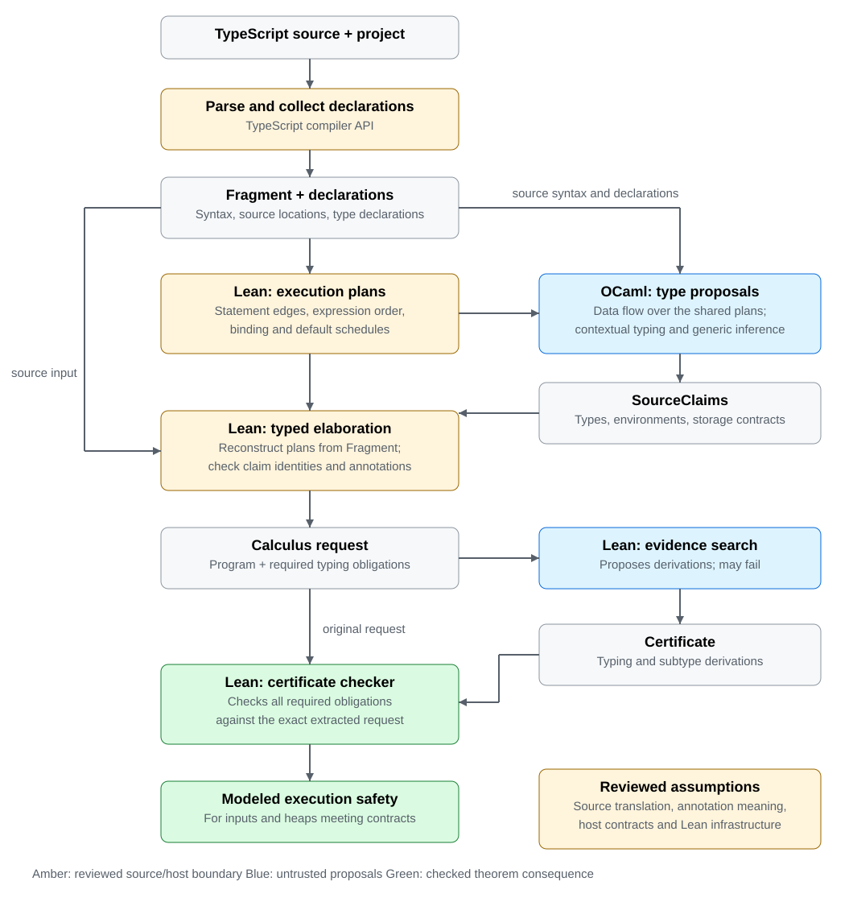

# Independent verification of SKJS results

The pipeline checks type claims about TypeScript programs with a small,
independently justified consumer. A producer proposes the types of a
module's expressions and the environments at its program points; Lean checks
that those claims are derivable in a calculus whose rules are proved sound
against an execution model. The OCaml producer, which reads TypeScript's own
declarations, is the one that moves; SKJS's exporter and the older
TypeScript-checker exporter are frozen ([below](#skjs-is-frozen)). No
producer is trusted.

This document states the current design and what comes next: the principles,
the architecture, the model in brief, the trust surface, the fragment's
boundary, the lasting decisions and the open work. It does not restate
rules. The [documentation map](README.md#documentation-ownership) assigns
them: terms, values and execution to [SEMANTICS](SEMANTICS.md), types and
subtyping to [POSITIVE-TYPES](POSITIVE-TYPES.md), program and source rules to
[PROGRAM-TYPING](PROGRAM-TYPING.md), wire formats to
[REQUEST-PROTOCOL](REQUEST-PROTOCOL.md) and [SOURCE-CLAIMS](SOURCE-CLAIMS.md).
How much of SKJS's own test suite verifies, and what stops the rest, is
[SKJS-COVERAGE](ocaml-producer/SKJS-COVERAGE.md). Works the design draws on
are cited from [REFERENCES](REFERENCES.md).

**The experiment's boundary.** The pipeline checks SKJS; it does not change
it. SKJS's acceptance, inference and diagnostics stay as they are, and only
extraction that preserves them belongs here. A safe program SKJS rejects is
an incompleteness finding to keep, and a claim the verifier refuses is a
finding about SKJS or about the pipeline, never a reason to weaken a rule.

## Principles

**Soundness is no wrong values.** An accepted unit, run in any environment
meeting its inputs, evaluates to a value of its declared type, takes a step,
or throws a value: it never gets stuck and never produces a value outside its
type. A throw is an outcome, as in ML-style soundness with exceptions
([Wright and Felleisen 1994](REFERENCES.md#wright-and-felleisen-1994)): a type
says what a value is, never that none is thrown. Termination is not claimed.
What is refused because it could produce a wrong value stays refused; what
would only throw is admitted (`BigInt(1.5)`, a bigint division by zero,
`toString(radix)` out of range).

**Types express what is actually true.** A type states what holds of every
value JavaScript can give it, no more. `s[i]` is `string | undefined`, since
a string's length is not tracked; a number's falsy part is all of `number`,
since no type names `{0, -0, NaN}`; an array may own keys its type does not
name; a fresh literal owns exactly its written keys, and a record type is
open. Where TypeScript states more than is true, the model states less, and
the program must justify the rest.

**Lean is the authority; OCaml proposes.** Every claim, contract, instance,
loop head and construction hint the producer supplies is a proposal that Lean
checks against the source it reads itself. Search strategy, fuel and hints
decide whether evidence is found, never what acceptance requires. A search
that finds nothing leaves a unit *unverified*, never disproved. The consumer
must stay usable with evidence from any producer.

**One mechanism, not two.** A new source form reuses the rules that exist:
every guard is a tag test; every array is one store and one prototype; every
intersection is one meet; every body, function or closure, is graph code;
every library contract is read through one overlay mechanism; one headline
theorem covers every accepted unit. A second typing path for a case the first
covers is not added, and a form that needs one waits until the first is
extended.

**Follow TypeScript where it is sound; refuse, with a reason, where it is
not.** The source is TypeScript and the pipeline reads it as TypeScript's
checker does: names resolve as it resolves them, computed types mean what it
computes, contextual types are its. Where TypeScript's rule is unsound
(method bivariance, covariant mutable arrays, implicit index signatures,
width subtyping into optional fields, narrowing an open record by `in`), the
form is refused with the specific reason, located at the source. Where
TypeScript refuses what would merely throw (arithmetic mixing a number and a
bigint), the pipeline follows it too: its rule is sound and the program is
almost surely a bug.

**Minimal, stated trust.** Every assumption is named and enters the safety
theorem as a premise: an input slot of the unit at a declared type, or a
listed property of the host. The [trust surface](#trust-surface) lists all of
them. Library contracts are TypeScript's declarations filtered by reviewed
overlays that record the text they were reviewed against, so a changed
library is refused rather than trusted silently.

**Evidence is syntax-directed.** Claims attach to source spans and
statement entries; loop heads and joins are supplied, and every incoming edge
must justify them. The checker infers no invariant and computes no join. What
a producer states at a program point is exactly what is checked there, and
source maps, which say how a node reads in the source, never reach evidence.

## Architecture

[Open the full-size diagram](diagrams/architecture.svg). Green nodes are
connected by Lean proofs; amber nodes are source and model meaning that is
reviewed, not proved. The producer is outside the soundness argument, and the
request reaches the consumer directly: evidence cannot substitute another
program or weaker requirements.

### Stages

- **The parser** (`tools/fragment-parse.mts`, trusted) reads a file with
  TypeScript's own compiler API. Its gate admits the fragment and refuses
  everything else with a located reason; it lowers source rewrites (unbraced
  arms, `switch` as labeled blocks, templates as concatenations, enums, async
  forms as intrinsic calls) and emits the Fragment AST. Its declaration
  reader (`tools/declaration-graph.mts`, `type-term.mts`,
  `computed-types.mts`) writes the declaration document: every type the
  module names, as source terms, with imported, ambient and global values,
  the prototype contracts and the intrinsics the module uses.
- **The OCaml producer** (`ocaml-producer/`, untrusted) proposes claims: an
  expression type at every span Lean asks about, an environment at every
  statement entry, loop heads, the storage contract of an unannotated `let`,
  instances of generic calls, and rows it reserves for arrays, applications
  and meets it names without computing. Where TypeScript types by context,
  the producer proposes what TypeScript would: an unannotated closure's
  result widened, or the contextual return type where the body fits it; a
  fresh literal at a union built at the one arm its keys, length and literal
  members select; an unannotated constant's fresh array built at the array
  type its first use expects; a binder in `A | null` inferred from the
  actual's other atoms; a loop head found by running the body until what it
  claims of each cell is stable. Each is a construction hint Lean checks, and
  adds no trust.
- **Lean** (`lean/Verification/Model/`) reads the AST and declarations,
  lowers every annotation once to claim form (`DeclarationGraph.prepare`),
  lowers each code unit to a graph request (`SourceExtraction`), searches for
  evidence (`--produce-source-claims`) and checks it
  (`--check-source-claims`). Only the check is part of acceptance.

### Claims and the claim reader

A claim is a type at a source site, in one claim form shared by producers,
annotations and the declaration graph: rows of the request's type table,
built from clauses. Annotations become claims in `DeclarationGraph.prepare`,
so there is one reader of types, not one per producer; a claim-shaped
annotation in the source tree is refused. Claims are per unit, keyed by
source identity; each site has at most one, a required site without one is
refused, and extra or duplicate claims are refused. A producer's claim is
compared with the source's annotation by meaning, not by label: a function's
claimed signature must mean its annotation, a closure's claimed signatures
must lie within it, and the body is checked at each claimed signature
([claims against annotations](PROGRAM-TYPING.md#modules-and-code-units)).
SKJS's exports are imported into the same sidecar form
([SOURCE-CLAIMS](SOURCE-CLAIMS.md)) and read by the same consumer.

Positions associate claims with syntax; they authorize no edit and establish
no truth. Alongside the graph, the extractor records a **source map**: how to
describe each node and its bindings in the source's words, for diagnostics
only ([obligation diagnostics](OBLIGATION-DIAGNOSTICS.md#node-and-expression-obligations)).
It has no decoder and never reaches a request or evidence.

### Search

Search (`CertificateProducer`, `--produce-source-claims`) finds evidence for
the claimed program; it is untrusted and replaceable, and the check runs none
of it. A node whose term the extractor built with known evidence (a closure
creation, an array literal, an element read) carries that plan, which is
rendered, not searched; elsewhere search tries a sequent's own types before
the vocabulary, which is only what the file's request mentions. Subtype
search proposes finite core tables, instance tables and arrow certificates,
first over the types near the pair, then over a table grown from the pair on
demand (each row adding the rows relating what its coverage compares, until it
closes: how two instances of a recursive declaration unfold together), and
prunes rows that no table could make valid. None of this changes what is checked: orderings and pruning decide
only how soon evidence is found, and the checker validates every table
([producing evidence](PROGRAM-TYPING.md#producing-evidence-from-supplied-claims)).
A failed search is refused by name for display only: `producer --explain`
lists the forms with a known reason and their spans, the innermost one that
meets the failed obligation is shown first, and with `--typescript-errors`
code TypeScript also refuses is named by its nearest error (a gate's or the
producer's refusal, which names no obligation, by its first). Nothing of this
is a premise; Lean decides on the ordinary proposal
([a failed search refused by name](OBLIGATION-DIAGNOSTICS.md#a-failed-search-refused-by-name)).

### The one entry

`ocaml-producer/check.mts` is the one entry for a file: parser, producer,
Lean search, Lean check, each a phase with its own log and a wall-clock
limit (`stepTimeoutMs`). The outcome is `verified` (the check accepted),
`unsupported` (a located refusal by the gate or the producer), `unverified`
(search or check found no derivation; never a disproof) or `error` (a step
failed or timed out; never a verdict). `--project` names the TypeScript
project the file belongs to, whose `tsconfig.json` must be strict.
`run-cases.mts`, `test.mts` and the coverage run (`skjs-coverage.mts`) go
through it; only the frozen corpus (`examples.mts`) runs the SKJS and tsc
producers on its own.

### What "verified" means

`SourceClaimJson.checkJson_safe` is the headline theorem. Its premise is the
exact CLI success condition; its conclusion is that every extracted plan was
certified, and that for every accepted unit's request, every assignment
$\eta$ of its parameter rows, and every environment meeting the unit's
inputs at $\eta$ in an admissible world with a satisfying heap, the graph is
safe at its declared result read at $\eta$ (`SafeGraph`). Every plan is a
graph request: a generic unit and a generic closure are checked by the same
checker, their binders parameter rows. The inputs are the unit's
parameters, the module values it reads, and every assumed value: imports,
ambient declarations, globals, prototypes, intrinsics. Every plan reaches
acceptance through one exhaustive conversion to `CertifiedPlan`; no variant
can be dropped. The proofs use no `sorry` and no project axioms. What the
definitions mean is reviewed, not proved; see
[what the checked development establishes](SEMANTICS.md#what-the-checked-development-establishes).
How the theorem relates to a JavaScript run, and what a connection to a
mechanized ECMA-262 semantics would add, is sketched in
[ECMA-CONNECTION](ECMA-CONNECTION.md).

### Modules and code units

A source file is a module, and the module is the unit of verification.
Obligations stay per code unit, so a failure points at one place: each
function, and the module's initialization, which runs its constants, classes,
enums and expression statements in order and checks every class's methods
and constructor. A module function is checked at its annotated signature, a
source-fixed slot no producer claims; a module constant is read at its
annotation or at the initialization unit's claim for its initializer, which
that unit checks. The initialization unit refuses a call that can read a
constant before it is initialized. Values the module does not define (imports,
ambient declarations, globals) join its scope at their declared types as
assumptions ([rules](PROGRAM-TYPING.md#imported-ambient-and-global-values)).

Composition is not yet a Lean theorem: a unit's result is relative to the
signatures of the module values it reaches, each certified by its own unit.
`--function` selects one unit; the rest of the module stays its scope. The
viewer shows one unit at a time, with the module's units as an outline.

### Generic bodies

A generic unit is an ordinary graph request whose binders are **parameter
rows**: rows the graph's assignment interprets and no rule reads.
`Parametricity.accept_reassign` proves acceptance independent of that
assignment ([Reynolds 1983](REFERENCES.md#reynolds-1983)), so one derivation is safe at every instantiation
([Generic-Body](PROGRAM-TYPING.md#overloads-polymorphism-and-binding)).
Records, tuples, arrays, field reads and writes, literals, calls of other
generic functions at a binder: whatever the graph checks for ground types it
checks over a binder, with no rule of its own. A bounded binder is the meet
of its row and its bound. A generic class's binders belong to the
initialization unit that declares it, so its constructor and methods are
certified at every instantiation. A call of a generic module value names its
instance, checked against the value's signature and bounds
([instances](PROGRAM-TYPING.md#imported-ambient-and-global-values)).

A generic closure is graph code at a scheme row
([`funScheme`](PROGRAM-TYPING.md#judgments-and-constructor-views)): its
claimed scheme becomes a row whose binders are fresh parameter rows, every
claim and annotation inside it reads its binders as those rows (a bounded one
as its meet with the bound), and its code is checked once, at the scheme's
signatures. A code table entry holds at every assignment of the parameter
rows (`CodesSound`, `checkCodes_reassign`), so at every instantiation; the
captures' types read none of the binders, so they mean the same at each.
Generic closures nest, in function bodies and in generic ones alike. A call
names its instance: the callee is read at the instance's signature, below the
scheme by a checked instance (`Sub.inst`).

A binder bounded by another, `U extends T`, is the meet of the two
parameter rows, within `T`'s clauses if it has any: a meet row may name
several parameters, and is below each of them and below a meet of some of
them within the same clauses ([`meetBelow`](POSITIVE-TYPES.md#core-tables)).
A generic closure's binder is read so too: such a bound reads a binder,
which a scheme row's bounds, read outside its binders, cannot, so the meet
alone states it, and at every instantiation within the bound the meet is the
binder. An instance maps a meet row of several parameters to the meet of
their instances with its clauses (`meetOk`), which is what a call's
claimed instance names. An intersection an annotation writes over binders,
`T & U`, `T & "fixed"`, `T & A`, is the same meet row, each binder read as
the unit reads it. Every generic unit and every generic closure is a
graph request; there is no second checker for generic bodies.

### Closures are graph code

A closure's body is a graph, as a function body is (`funGraph`,
[graph code](SEMANTICS.md#graph-code)), checked by its own certificate at
each signature its claim offers, entered with its receiver, parameters and
captured slots. Mutable locals, loops, `switch`, `try` and patterns inside a
closure are the same graph shapes as anywhere; a generic closure's code is
checked at its scheme's signatures ([generic bodies](#generic-bodies)). There
is no other closure code: every kind of closure is graph code, and one rule
creates each kind. The calculus has no other code either: an object's call
code is graph code, `.bind`'s forwarding descriptor, or none
([call codes](SEMANTICS.md#graph-code)).

- **A rest parameter** makes the code collect the actuals past its fixed
  parameters into a fresh store, in slot 0 of the frame, below the receiver
  (`CallArguments.graphEntry`). Such code offers only variadic signatures,
  each checked from the frame with the store at its rest's store type
  (`CodeOffers`, `restsT_of_graphRest`).
- **A parameter default** is an entry node: a tag dispatch on `undefined` at
  the parameter's slot, the default's evaluation on one arm, first in the
  graph, in the order `parameterOrder` fixes, as a function's default is.
- **A generic closure** with either is graph code at its scheme row
  (`funScheme`), as any generic closure is.
- **A class constructor** is construct-only graph code (`ctorGraph`), checked
  at each construct signature from the frame with `undefined` for the
  receiver `new` passes (`ctorsT_of_graph`). A constructor's default is its
  entry node as a closure's is. The realm's array invariant asks nothing of
  a class value, as of any value carrying code: its clause is no record's
  (`realmInvariant_of_not_record`).
- **A callable object** built by `Object.assign` allocates its bag as a
  record's with graph code offering the advertised signatures, one code-table
  entry per signature (`callableGraph`).

A closure's code is checked in its own table entry, not inside the creating
body, so the creating body's certificate only names the entry and the
captures' types.

### SKJS is frozen

Past the tag `skjs-frozen`, the parser → OCaml producer → Lean pipeline is
the one that moves. The SKJS producer, the claims converted from it and the
suites built on its fixtures stay as they were at the tag;
`verification/run.sh` runs them only with `--suite all`, and they may fail on
arrays, which past the tag hold `Array.prototype`.

### SKJS operation contracts

Beyond checking SKJS's conclusions, the model can give its individual
operations semantic contracts, so a repair is judged against meaning rather
than the current implementation. `--check-skjs-operations` checks closed
subtype and expansion judgments SKJS exports under the substitution in force
at each ([closed operation export](REQUEST-PROTOCOL.md#closed-operation-export)).
The contracts:

1. **Substitution preserves meaning.** Substituting type arguments into
   syntax means the same as interpreting the syntax under the corresponding
   assignment.
2. **Expansion and normalization have explicit guarantees.** An exact
   expansion preserves denotation; an approximation establishes the
   appropriate inclusion; a cache preserves that guarantee in the state it is
   reused in.
3. **Successful subtyping establishes semantic inclusion**, `Δ ⊢ A ≤ B`
   implying `⟦A⟧η ⊆ ⟦B⟧η` for every `η` satisfying `Δ`, as the calculus's
   own `Sub.sound` does.
4. **Inference cannot invalidate earlier checks**: commitments are stable,
   preserved across state changes, or revalidated.

A generic parameter (every admissible `T`), an inference variable (a `T`
the checker may choose) and an object's hidden type argument (a fixed `T` it
may not choose) are different obligations and must not be confused. SKJS
repair progress is tracked in
[docs/skjs-improvement.md](../docs/skjs-improvement.md).

## The model in brief

Each section names what the model has and links the rules; none is
restated here.

### Values

`null`, `undefined`, Booleans, numbers (a number is the bit
pattern of its IEEE-754 double; the literal type `0` denotes both zeros),
bigints (the integer), strings, symbols (opaque identities), objects (a map
from property keys, strings or symbols, to locations), arrays, and functions
with call or construct code. Binary operators are one term, `arith`, whose
meaning is JavaScript's operation where it converts nothing: `+` concatenates
a string with any primitive but a symbol by `ToString` exactly (`Number::toString`
digit for digit), `%` is the exact remainder, relational operators compare
two numeric values or two strings, and `===` is `IsStrictlyEqual`
([operational language](SEMANTICS.md#operational-language)).

### Heap and contracts

Every location carries a stable invariant contract in
the world; heap satisfaction ties contracts to contents, and a write must
meet the location's contract. References are invariant views of storage, not
covariant containers. Functions are safe in every admissible future world
([types, worlds and heaps](SEMANTICS.md#computations-and-recursive-types);
[Ahmed 2004](REFERENCES.md#ahmed-2004)).
Recursive types are finite guarded graphs, interpreted by a budget-indexed
fixed point ([POSITIVE-TYPES](POSITIVE-TYPES.md); [Appel and McAllester 2001](REFERENCES.md#appel-and-mcallester-2001)).

### Current-content assertions

What a location holds now is separate from its contract. `{ value: boolean =
true }` records a Boolean contract and currently true contents. Observations
are duplicable facts: they neither narrow the contract nor grant writes
([semantics](SEMANTICS.md#current-content-assertions-and-postconditions),
[rules](PROGRAM-TYPING.md#current-content-rules-semantic-layer)). A
statement entry is an exact interface: its supplied types and observations
are the whole starting context, plus the distinct-location links the
extractor states (a private cell is a fresh allocation, apart from the fields
of older bindings and later literals). A write of a known primitive
establishes new contents, and one of a value whose type rules `undefined`
out that the cell holds some other value, read at its contract less
`undefined` (so `let x: T;` assigned an object on every path reads at `T`);
a call forgets every heap fact, since a callee may
write any location its operands reach and the model states no reachability.
Immutable values and slot equalities survive. A closure's entry claims must
follow from contracts, never from creation-time contents. Loop heads are
supplied, and every back edge must establish them
([checkpoints](PROGRAM-TYPING.md#source-observation-checkpoints)).

### Mutable bindings

A `let` and an assigned parameter are private cells
with a storage contract fixed where they are declared: the annotation, or
the producer's proposal (TypeScript's widened or evolved type), against which
the initializer and every write are checked. A closure holds the cell's
identity; a `const` copy holds a snapshot, and an unannotated constant of a
named union is held at the union's arms, as an annotated one is, an
annotated one initialized by an object literal at the arms the literal may
be of (TypeScript's narrowing on assignment); a constant's object literal
used whole where an optional field it leaves out is expected is claimed
with its exact keys
([rules](PROGRAM-TYPING.md#mutable-bindings-and-module-constants)). A `let`
statement whose initialized bindings nothing in their scope writes, closures
included, is a `const`: each holds its initial value throughout, so a test
narrows it and a `let` pattern binds (`LET-CONST`). A `let` that is written
and holds a union of objects is not narrowed by a test of its object: a
cell's known contents are primitive or merely no `undefined`, and a write in
between may replace it.
A written `let` pattern binds hidden names, then each source name is a
cell of its own at its value.

A local may hide an outer binding of its name. The parser renames it, by
the declaration TypeScript binds each reference to, to a name no source
spells (`x@line:col`), so the lowering never meets two bindings of one name:
$\alpha$-conversion, for `const`, `let`, parameters, patterns, closure
parameters, `for...of` and `catch` bindings in any body
([shadowing](PROGRAM-TYPING.md#derived-source-forms)). A mention above the
declaration, a closure's included, or in its own initializer is refused, as
JavaScript's temporal dead zone throws there.

### Objects and prototypes

An object's keys are fixed at its allocation; a
write stores at an existing location and never adds a key. A source write
that adds a key, `o.k = e` where `o`'s type does not state `k`, is the copy
of the object with the key (an allocation from parts), which the local holds
from then on: JavaScript's write in place and the copy agree because nothing
else can observe the object the copy replaces. It is lowered so only on a
local's own fresh object that nothing else has reached (not passed, stored,
captured, returned or copied to another binding, and outside any loop its
declaration does not enclose); on any other object it is refused, since
another reference would see the object's keys change
([key-adding writes](PROGRAM-TYPING.md#key-adding-writes); a strong update
where the location is unaliased, as in
[Smith, Walker and Morrisett 2000](REFERENCES.md#smith-walker-and-morrisett-2000)).
A record type is
open: it constrains the keys it names and says nothing of others. An
**own-key bound** says which keys an object may own, $\mathsf{among}\,K$ or
$\mathsf{outside}\,N$ ([records](POSITIVE-TYPES.md#records)); a fresh
literal's own keys are exactly its written ones, which is how it meets a
readonly dictionary or leaves out an optional field; a literal meant for a
writable dictionary is allocated at it instead
([index signatures](#writable-string-index-signatures)). An object may hold a prototype
under the reserved key `[[proto]]`, and a read of a key the object lacks
continues there (`readProto`). A class instance holds its class's prototype
object, whose methods it reads; a derived class's prototype links to its
base's. A private name `#x` is a key no code outside its class spells, a
symbol of its own: a private field an own key of each instance, a private
method the prototype's, a static one a binding; a copy takes none
([classes](PROGRAM-TYPING.md#classes)). Optional fields read an absent key as `undefined`, which holds only
without a prototype, so they require none. `readonly` is a view: a read
capability that withholds writes through that view without retyping the
location.

### Object literals

A literal allocates one object owning exactly the properties it writes, in
order. A spread of a literal is its fields; a spread of any other value is an
allocation from parts, copying the value's own enumerable string-keyed data
properties when it is evaluated
([allocation from parts](PROGRAM-TYPING.md#allocation-from-parts)): a class
instance's methods are its prototype's and are not copied, nor is an
`Error`'s non-enumerable `message`, nor a symbol-keyed property. A numeric
key is the property its `ToString` spells, and a computed key naming a
`unique symbol` constant (`Symbol.iterator`, or one the program makes) is that
symbol's key; `__proto__`, any other computed key and accessors are refused. An object pattern's rest is the same copy less the
named keys. Where a part is a dictionary and every part says what it gives
under the index's keys, through an index or its exact keys, the result is a
writable dictionary at what the parts give there; a spread of an open record
meets no index. `Object.assign` is the same copy, onto a fresh literal or,
as a statement, a local's own object, from sources whose types rule out an
own `__proto__`, which it would set through the prototype's setter.

### Arrays

An array is one store of element locations under the reserved
store key and one object holding `Array.prototype` under `[[proto]]`, read
through the one array shape (`arrayClauseOf`,
[arrays](POSITIVE-TYPES.md#arrays)). Its own keys are outside $N$, the keys
`ArrayProto` provides, so `xs.map` reaches the prototype; it may own others,
as Skip's runtime tags managed arrays with a symbol key. Arrays are
**dense**: every index below the length holds an element, so an element write
is typed only in bounds or appending. Mutable arrays are invariant;
`readonly T[]` reads only and is covariant. Arrays are `Iterable<T>` through
their prototype's `[Symbol.iterator]`, a tuple through the readonly array of
its positions. An array's `length` is read from its store, in a statement and
in a closed expression alike. An array pattern's rest over a tuple of
required positions is reads; any other is a slice, a call of the trusted
`%RestFrom:k%` ([patterns](PROGRAM-TYPING.md#patterns)).
Every record and dictionary type is of objects meeting the **array
invariant**: one owning the store key is an array of the realm, a dense store
and `Array.prototype`, owning no key it provides. Allocation keeps it, since
an allocation owning the store key is typed only as such an array and a
merge copies no store; it is assumed of every value a unit receives at such a
type ([the array invariant](SEMANTICS.md#the-array-invariant)). So where
`Array.isArray` holds, a record arm is `readonly unknown[]`. `unknown`, which
is also what a handler binds a thrown value at, carries no invariant.

### Index signatures

A dictionary is a `dict` clause of index contracts, each over a **key class**:
every string key, the canonical numeric keys (a string some number's
`ToString` spells), or every symbol key
([records](POSITIVE-TYPES.md#records),
[source forms](PROGRAM-TYPING.md#index-signatures)). A read at a key the
object may lack is `V | undefined`. A mutable index is a **writable index
contract**.

#### Writable string index signatures

A mutable index signature lets code holding the dictionary add keys and
overwrite values at `V`, and TypeScript also treats it covariantly. Lowering
it to the readonly view would be unsound: a caller handed a dictionary of
`true` at `{ [key: string]: boolean }` could store `false` where the program
still reads `true`. So every present field under its class holds exactly
`V` (`dictCellT`), a mutable dictionary is invariant, and a readonly one is
never mutable. The program adds a key to a dictionary only as it adds one
to any object, by copying a local's own object with a key the source spells.
A write at a key known only at run time is refused: through a dictionary
another reference may hold, as any key-adding write is; on a local's own one
at a string, since the string may spell a key the model keeps for itself
(`[]`, `[[proto]]`), which JavaScript owns as an ordinary property; at a
number or a symbol it is not yet lowered. That code outside
the unit adds keys to a writable dictionary only at its contract, and only
keys of its class, is an assumption ([trust surface](#trust-surface)). Every
type the checker lets the unit hold such an object at stays true of it with
such a key, so every capability it grants is kept. Covering a writable index
requires every index and optional field of the source over its keys to admit
`V`, and every own-key bound of the source to keep its class: none lists keys
(the class has keys it does not list) and none excludes a key the class may
admit (`KeyBound.keeps`, [covering](POSITIVE-TYPES.md#records)), unless no
value meets `V`, so no key can be added. A bound is
the one capability the writable contract does not imply: a value met as a
writable dictionary through one could be held elsewhere at a type saying a
key is absent that outside code then adds. So a record meets a writable index
through a bound only at an uninhabited contract (`CoversKeys`); a literal meant for a
writable dictionary is allocated at it, with no bound
([`allocDict`](PROGRAM-TYPING.md#judgments-and-constructor-views)); a merge's
dictionary result states only bounds that keep its writable classes. That a
kept bound survives a key of its class, and that every clause covering a
writable index has only kept bounds, are theorems (`ownKeysT_keeps`,
`covers_writable_keeps`, `covers_writable_bounds_grow`); that fields, views,
indexes and optional fields survive it is the argument above, which the
covering premises state.

A read `o[k]` whose key is one of several string or number literals tests
`k` against each and reads that member (NaN excluded).

### Method members are host-relative

A method member's contract is relative to its host: read from `o` and invoked
with receiver `o` and admitted actuals, it behaves as typed, and it promises
nothing for another receiver ([`methodT`](POSITIVE-TYPES.md#records)): the
self-application of [Abadi and Cardelli 1996](REFERENCES.md#abadi-and-cardelli-1996). A
method call reads the member and binds it to its host in one term
(`bindMember`); nothing types a member read on its own. Consequences, each
forced by soundness:

- A method is not a function-typed property: the property covers the method,
  never the reverse (`const g = p.m; g()` would throw).
- Extracting a method (`const f = o.m`, `xs.forEach(o.m)`) gets nothing; the
  supported forms are `o.m.bind(o)` and class-field arrows.
- Method parameters are contravariant; TypeScript's method bivariance is
  refused.
- Interfaces with methods are covariant in results, so a class instance meets
  an interface it structurally meets, and an array meets `Iterable<T>`.
- Method members are read-only views: a write to one is refused.
- A class method taking fewer parameters than an interface's member is
  claimed at the longer signature as well, the extra actuals discarded at
  binding (`CodeOffers`); no subtyping widens an arrow's parameters.

A generic method is a member with **quantified signatures**: a scheme the
member bound to its host meets, whatever receiver the bound function is
later given (`MethodMembers.boundOn`). It is the same host-relative promise,
read through `.bind`, so the scheme's own receivers admit every value, and a
call binds the member (`bindScheme`) and names its instance below the scheme.
Two quantified members relate as their schemes do, by the covering rule for
quantified signatures ([core tables](POSITIVE-TYPES.md#core-tables)): equal
binders, the source's bounds among the target's, the target's signatures
covered with its binders opaque, so decidable
([Pierce 1994](REFERENCES.md#pierce-1994)). Since the receiver is the host on
both sides, it is never compared, and a declaration whose generic methods take
its argument only covariantly is covariant: `Promise<A>` is below `Promise<B>`
where `A` is below `B`, by `then`'s and `catch`'s own signatures. A
generic method's binder rows are its member's, keyed by its key, position and
bound ([generic methods](PROGRAM-TYPING.md#generic-methods)), so members of one
key declared alike bind the same rows: `Promise<A>` is below `PromiseLike<A>`.
A class's generic method is such a member of its instance type, which its
prototype's closure, a scheme received by the instance whose binders are the
member's rows, covers bound to the instance
([classes](PROGRAM-TYPING.md#classes)).

### Exact contracts and native effects

A source declaration is lowered in full or refused. Unsupported generic
bounds, mixed value/argument-pack binders, and exhaustion of the binder-colour
or application budget are refusals. No such failure denotes `unknown`, and no
method is dropped. This matters in result and writable positions: forgetting
a contract there would certify a value that does not satisfy its annotation.

Native contracts are reviewed separately from their TypeScript declarations.
`find` and `findIndex` callbacks receive `T | undefined`: a prior callback can
shrink even an initially dense array through another reference, while these
methods visit the original index range. `map` visits only present indices,
but shrinking its source can leave holes in its result. Until sparse arrays
are represented, its result contract is `unknown`, not a dense `U[]`.
`join` and default `sort` currently require primitive elements: implicit
string conversion must not invoke an unchecked client method. `sort` with an
explicit comparator accepts arbitrary element types: its two call contracts
are separate signatures of one quantified callable. The comparator is checked
at the element type; passing `undefined` selects the conversion-requiring
contract. No new core rule or sort-specific producer path is needed.

The native regression sources are also executed under Node. Source-contract
erasure is tested against both verifier entry points using a forged producer
proposal. These tests exercise premises and translation that the calculus
safety theorem does not prove. Intrinsics are collected on demand; a loop no
longer brings in unrelated Promise declarations.

### Calls

Argument lists are native: the callee is evaluated first, then
the actuals left to right; a missing trailing actual binds `undefined`, so
`x?: T` is `T | undefined` and a default's position admits `undefined`;
extra actuals are discarded after evaluation. A function type promises which
actual lists a caller may write and what the call then guarantees
(`callsT`, `restsT`), independently of the code's arity
([one meaning for callable contracts](SEMANTICS.md#one-meaning-for-callable-contracts)).
A rest parameter makes the code variadic: invocation collects the remaining
actuals into a fresh array, viewed at the rest's type: an array or a tuple of
required positions, readonly or not, or a declared alias of one, a generic
alias read through its equation at the reference's arguments. A rest typed by a binder is an argument pack,
whose contracts are over lists at the actuals' own level
([argument packs](POSITIVE-TYPES.md#argument-packs)). A closure claimed at
several signatures is checked once per signature. A spread among the actuals
is replaced by its store's elements once every earlier actual is a value;
spreads may sit at any position of fixed parameters or feed a generic
signature's inference, and an actual after a spread that runs code is refused
(the elements are read after every actual). A union callee is called at every
arm, its result the union of theirs; a method call on a union whose arms'
members differ reads and calls in one step dispatched on the receiver, where
every actual is a name or a literal. A callee that is a callable with fields
is refused ([call rules](PROGRAM-TYPING.md#reading-the-source)).

### Primitive members

A member read on a primitive is read through the
realm's wrapper prototype (`String.prototype`, `Number.prototype`,
`BigInt.prototype`, `Boolean.prototype`) with the primitive as receiver; a
string's `length` and indices are its own
([prototype contracts](PROGRAM-TYPING.md#prototype-contracts)).

### Receivers

Every signature states its receiver and every call passes one:
`undefined` for a plain call, the object for a method call, the first
argument for `.call` and `.apply`. The receiver rule is strict mode's; a
sloppy function that reads no `this` is the strict one, its receiver being
unobservable. `.bind` allocates a forwarding descriptor whose
receiver a later `.bind` or `.call` cannot replace (`callsT_bound`).

### Generic types

A generic application with methods is one row per
declaration and arguments for the module, lowered from an empty visit, so a
recursive family of applications is a finite graph
([one row per application](PROGRAM-TYPING.md#one-row-per-application)). A
generic method is a [member with quantified signatures](#method-members-are-host-relative),
a scheme row whose binders are parameter rows coloured per member; a
binder intersected with ground types is a meet row
([rows](POSITIVE-TYPES.md#parameter-and-scheme-rows)).

### Graphs

A body is a finite graph of nodes, each evaluating one term then
returning, binding, discarding or branching; destinations carry explicit slot
maps, checked on every edge; a node may name a handler for a throw out of its
term ([control-flow graphs](PROGRAM-TYPING.md#checked-control-flow-graphs)).
Global safety covers cycles without unrolling.

### Throws

`throw a` evaluates `a` and throws its value; a throwing term does not step,
and every evaluation context carries the throw out
([semantics](SEMANTICS.md#computations-and-recursive-types),
[rule](PROGRAM-TYPING.md#throwing)). The primitives JavaScript throws on step
to throwing an error object (`binopThrows`): a bigint division or remainder
by zero or a negative exponent, and, where the gate admits them at all, a
number mixed with a bigint or a symbol converted. A handler binds the thrown
value at `unknown`, under only the facts that hold without the heap
(`handlerFacts`), since the body may have run any effect before it threw. A
`finally` block is compiled on every way out, returns and jumps included: a
`break` or `continue` runs each `finally` it passes, innermost first, then
lands ([try](PROGRAM-TYPING.md#statement-forms)).

### Guards

A guard is a test JavaScript defines exactly. It is followed where the model
answers it as JavaScript does, as one more tag test (`Tag`, `tagHolds`), so
it narrows by the one mechanism of tag observations (`tagSlice`), and refused
with the reason where the model would answer otherwise
([rules](PROGRAM-TYPING.md#guards)). The tests are `typeof` (eight shapes,
`"object"` being `typeofObject`: `null` or an object without call code),
`key in o` (`hasKey`, along the prototype chain the model holds), truthiness
(`ToBoolean`), `== null`, strict equality against a singleton of any
primitive kind, `Array.isArray` and `instanceof Array` (`isArray`: owns the
store key; a record or dictionary arm is then the realm's `readonly
unknown[]`, by the [array invariant](#arrays)), and `x instanceof C` for a
class the file declares (`hasKey` of the key only `C`'s prototype owns; it
narrows a union's arms, never `unknown`, since JavaScript gives any object
`C`'s prototype without `C`'s constructor). A test of a field of an
immutable binding's object against a singleton, or of its truthiness where
an arm leaves the field optional (an `IteratorResult`'s `done`), narrows the
object's arms; a
key found present promotes an optional field to a field, since an object
keeps its keys. A test on a mutable cell refines the read, never the cell.
`&&`, `||` and `??` return an operand, as JavaScript's do, by the same
tests; a chain of one of them reads right-nested, so each operand sees what
every earlier one answered. `x instanceof C` of a class whose chain of bases
holds a static `[Symbol.hasInstance]` is a call of that method, its result
converted by `ToBoolean`, and narrows nothing.

### Async and iteration

`await`, an async function's return and completion, `for...of` and a
spread over a host iterable, an array pattern's slice rest and `for...in`
are calls of trusted **intrinsics**, values no source name spells, whose
signatures the declaration reader states
([async](PROGRAM-TYPING.md#async-functions-and-await),
[loops](PROGRAM-TYPING.md#loops-and-spreads-over-iterables)). A loop over a
host iterable steps one **iteration intrinsic** family, `%Iterate:K%`, picked
by TypeScript's type of the iterable: an array's (`%Iterate%`), a string's, a
`Set`'s, a `Map`'s and a host collection iterator's; a spread collects the
same iterator into a fresh array (`%Spread:K%`). None of these iterators has
a `return`, so leaving such a loop early calls nothing. An iterable the
program defines (an object with its own `[Symbol.iterator]`, an
`Iterable<T>`) runs the **iterator protocol** of
[ECMA-262](REFERENCES.md#ecma-262) as ordinary calls, each typed
by TypeScript's `Iterable`, `Iterator` and `IteratorResult` declarations: the
parser writes GetIterator, `next` read once and called per step, the result's
`done` tested (a truthiness test of a field, which refines the result to its
not-done arm) and its `value` bound. IteratorClose is a **closing region**
around the loop's body, a `finally` that runs on some ways out only: before
a `break` of the loop leaves it, before a `return` returns, and, its own
throws discarded, before a throw out of the body resumes; not at the body's
end, on a `continue`, or when the iterator is done. It calls the iterator's
`return` where it is not `undefined`, whose result must be an object. A
spread of such an iterable is collected before its statement, where nothing
the statement evaluates before it can change, and an array pattern over one
steps once per element and closes the iterator where no rest took it to its
end. No calculus rule changes: a call's callee is an assumption at its
declared type, or code the unit checks. An async function's
promise settles only to a primitive, the values that are never thenables
([nested promises](ECMA-CONNECTION.md#illustration-nested-promises)).
The model runs a body to its end; every point where other code can intervene
is an `await` or a call, across which only contracts survive.

## Trust surface

Everything the safety theorem does not establish. Each assumption enters as
a premise: an input slot of the unit at a declared type (`EnvOk` over the
unit's inputs, in the premise of `checkJson_safe`), a property of the host
the model's reading of an operation relies on, or the correctness of a
trusted tool. Where an item is stated in code, that code is the reviewed
text.

**Trusted tools.**

| Assumption | Where it is stated |
| --- | --- |
| The parser represents the source faithfully: it admits only the fragment, and its lowerings (unbraced arms, `switch`, `for`, templates, enums, optional chains, async forms, patterns, dead code, a shadowing local's renaming by the declaration TypeScript binds each reference to, a `let` nothing writes as a `const` (a `for...of` or `for...in` head's too), a written `let` pattern as a `const` pattern and `let`s, a static block as a closure called at once, `instanceof` of a class with a static `[Symbol.hasInstance]` as its call, `k in o` with a key TypeScript types as other than string literals as `%HasProperty%(k, o)`, `xs[k]` of an array at a `number` key as `%ElementAt%(xs, k)`, a private name as its member's symbol, a rest parameter's alias equation, the iterator protocol of a program's iterable in a `for...of`, a spread and an array pattern, with its closing region) preserve JavaScript's execution. | `tools/fragment-parse.mts`, `fragment.mts` |
| Source extraction preserves control flow, lexical binding, evaluation order and annotations: which program point a claim is attached to is unproved. No source-to-graph preservation theorem exists. A key-adding write is lowered as a copy only where the object is its local's own and unreached (`growSites`, a syntactic analysis): that JavaScript's write in place and the copy agree rests on it. | `Source/Fragment.lean`, `Source/SourceExtraction.lean` |
| Decoding represents the submitted AST, declarations, claims and evidence faithfully. | `RequestJson.lean`, `SourceClaimJson.lean` |
| TypeScript's checker resolves each name to its declaration in the file's project, whose strict `tsconfig.json` (paths, links, library set, type packages) reflects the real build; a TypeScript error in a collected declaration or on an import it passes through refuses the graph. The parser checks TypeScript read the bytes it parsed. | `tools/declaration-graph.mts` |
| TypeScript's evaluation is trusted as its resolution is: a computed type (`typeof`, `keyof`, `T[K]`, template literal types, primitive intersections, mapped keys) means what its checker computes; an enum member's value is `getConstantValue`'s, which its emit writes; a `const enum` read is the member TypeScript binds it to; global member and overload resolution selects which declared signatures are assumed. | `tools/computed-types.mts`, `declaration-graph.mts` |
| The execution model agrees with JavaScript on the supported operations, including that Lean's compiled `Float` operations are IEEE-754's and `Float.pow` is C's `pow`, which `binop` corrects where `**` differs. | `Semantics/Calculus.lean`; edge cases in `Tests/SourceExtractionTests.lean` |
| Lean's kernel, its compiler (including the `@[csimp]` replacements, each proved equal to its definition) and the executed verifier binary are correct. | — |

**Assumed values.** Each is an input slot of the units that use it, at its
declared or stated type; nothing checks the code behind it, and each may
throw, which safety admits, but never return a wrong value.

| Assumption | Where it is stated |
| --- | --- |
| An imported value meets its declaration; a function declared with overloads meets every overload. | `IMPORT`, `OVERLOADS` in [PROGRAM-TYPING](PROGRAM-TYPING.md#imported-ambient-and-global-values) |
| An ambient declaration (`declare function`, `declare const`, `declare class`) holds of the value the environment supplies under that name; the declaration document lists it with the specifier `ambient`. | `AMBIENT`; `collectDeclarations` |
| A global variable outside the standard library (Node's `process`) meets its declaration at the members and calls the module selects, from the project's type packages, and no code the module does not see reassigns it. | `GLOBAL`; `selectGlobal` |
| Each standard library global meets its reviewed overlay entry: `console.log`; `BigInt`; `Symbol`, `Symbol.for`, `Symbol.keyFor` and five well-known symbols; `String` of a primitive; `Object.keys`, `Object.values`, `Object.entries` (and the generic two at a dictionary); `new Array()`; `Array.isArray` and `Array` as `instanceof`'s operand; `new Error(m)`; `new Set`, `new Map` of an array, `new Date` of nothing, a primitive or components, `Date.now`; the `Promise` statics and constructor, through the intrinsics below; `JSON.parse` of a string and `JSON.stringify` of a `JsonValue`. | `globalsOverlay` in `tools/library-globals.mts`; [rules](PROGRAM-TYPING.md#library-globals) |
| `Array.prototype` meets `ArrayProto`: its natives `forEach`, `map`, `reduce` and `reduceRight` (with an initial value), `every`, `some`, `filter`, `slice`, `join`, `indexOf`, `lastIndexOf`, `includes`, `at`, `find`, `findIndex`, `sort`, `push`, `pop`, `shift`, `unshift`, `reverse` and `[Symbol.iterator]` meet the reviewed overlay contracts, at the listed receiver, without `thisArg`; `find`/`findIndex` admit missing callback values, `map` returns `unknown`, and `join` and default `sort` restrict elements to primitives; comparator sorting checks the supplied callback. Units allocating arrays read it from the input slot `[[Array.prototype]]`. | `overlay` in `tools/array-prototype.mts` |
| `String.prototype`, `Number.prototype`, `BigInt.prototype` and `Boolean.prototype` meet `StringProto`, `NumberProto`, `BigIntProto` and `BooleanProto`, each member an own property of that prototype (`split`, `replace`, `replaceAll` stated at a string pattern; `toLocaleString` without `options`), read from the slot `[[String.prototype]]` and so on. | `primitiveOverlay` in `tools/array-prototype.mts` |
| `Set.prototype`, `Map.prototype` and `Date.prototype` hold the listed natives, unmodified (`keys`, `values` and `entries` giving a host iterator of the collection). | `interfaceOverlay` in `tools/array-prototype.mts` |
| The intrinsics meet their signatures: `%Await%` yields what a promise settles to or throws its rejection; `%AsyncReturn%` and `%AsyncComplete%` settle an async function's promise to a primitive or `undefined` (also `Promise.resolve`); `%PromiseAll%` (`Promise.all`), `%PromiseReject%` (`Promise.reject`), `%NewPromise%` (`new Promise`, calling its executor at once); `%Iterate%` steps an array's iterator, reading the current length at each step; `%Iterate:string%` a string's, by code point; `%Iterate:Set%` a `Set`'s, in insertion order; `%Iterate:Map%` a `Map`'s, a fresh `[key, value]` array per entry; `%Iterate:Iterator%` a `SetIterator` or `MapIterator`, which is its own iterator; none of these iterators has a `return`; `%Spread:K%` is the fresh array of what `%Iterate:K%`'s step yields until it ends; `%RestFrom:k%` is the fresh array of an array's elements from `k` to its current length, as its iterator yields them after a pattern's `k` elements; `%ForIn%` gives the keys a `for...in` visits, strings; `%HasProperty%` answers `k in o` for a key TypeScript types as other than string literals, as the host's lookup does; `%ElementAt%` reads `xs[k]` of an array at a `number` key as the host does: the element at an index below the length, an own property at another numeric key, else `undefined`. The job queue and a promise that never settles are not modelled. | `tools/intrinsics.mts`; [async](PROGRAM-TYPING.md#async-functions-and-await) |
| A thrown value is a value, of any type. | `Thrown` in `Safe` (`Semantics/Safety.lean`) |
| The runtime with the sound service binding meets its declarations: `InputCollections.get(definition)` returns the collection built from that definition at its types, or throws; resources are constructed with the request's `Json` parameters. | `ocaml-producer/upstream-sound/` |
| In the SKJS test environment, SKJS's import stubs describe the modules a test imports, and `skjs-environment.d.ts` the host's `process`, `__SKJS_show`, `__SKJS_show_expanded` and `StringRecord<V>` as SKJS's builtins stub does, with the ES2022 library and no DOM (`console` restated); `Closed<T>` and `SKJS_Ignorable<T>` are read as `T`; an ambient class's untyped field is a readonly `unknown` field. These are premises of the coverage result only. | `ocaml-producer/skjs-environment/`; `STUB`, `ENV` |

**Assumed of the host.** Properties of every value a unit receives, on which
the model's reading of an operation relies.

| Assumption | Where it is stated |
| --- | --- |
| The caller contract: a value conforming to a structural annotation (a parameter, an import, a library result) is a plain data object, its stated string-keyed fields own enumerable data properties, not accessors or proxies, which a spread copies, and a class instance owns its private slots, keyed by their private names; a conforming function respects its contract across every future heap, callback effects included. Two such parameters may alias. `Error`'s `message` is the exception, held on a prototype the model gives it. | `RequestJson.verify_safe` quantifies over environments meeting the input types |
| A value whose trusted declaration types it `Function` has call or construct code. | [`Function`](PROGRAM-TYPING.md#library-types) |
| A value TypeScript types as `Set<T>`, `Map<K, V>`, `SetIterator<T>` or `MapIterator<T>` that a loop or spread iterates is the host's: its iterator is the realm's, and the prototypes it inherits (`%IteratorPrototype%` included) hold no `return` and are unmodified. Assumed of every such value a program receives; the fragment builds none but through the host: a `Set`'s and a `Map`'s type state their `[Symbol.toStringTag]`, a well-known symbol key no literal or class of the fragment writes, and no annotation of the fragment states a `SetIterator` or `MapIterator`. A host iterator a program's protocol steps (an array's, as an `Iterable<T>`) likewise has no `return` along its chain. | the iteration intrinsics' pick, `iterationKind` in `tools/declaration-graph.mts`; `writtenSymbol` in `tools/fragment-parse.mts` |
| Every object owning the array store key is a JavaScript array: every object the model allocates, and assumed of every object a program receives. `Array.isArray` is the native test. For `instanceof Array`, every array a program receives is of its realm and no object but an array inherits from `Array.prototype`. | `isArray` ([SEMANTICS](SEMANTICS.md#operational-language)); the `Array` entries of `library-globals.mts` |
| The array invariant: every object a unit receives at a record or dictionary type that owns the array store key is an array of the realm: its store is dense, it holds `Array.prototype` (meeting `ArrayProto`, which reads no parameter row), and it owns no key `Array.prototype` provides. Proved of every object the unit allocates; assumed of every value it receives, as the arrays it receives at array types already are. Nothing is assumed of a value at `unknown`, and no class invariant: an object whose prototype chain holds a class's prototype need not have the class's fields. | `realmInvariant` in the meaning of record and dictionary rows, so `EnvOk` in the premise of `checkJson_safe` ([SEMANTICS](SEMANTICS.md#the-array-invariant)) |
| An array a program receives owns no key its prototype provides. | the $\mathsf{outside}\,N$ bound of the array shape |
| An array a program receives owns, at a canonical numeric key that is no index below its length, only a data property holding a value of its element type, as `Array<T>`'s declared `[n: number]: T` says; the realm's `Array.prototype` owns no numeric key. What `%ElementAt%` reads rests on it; the arrays the model allocates own no such key. | `%ElementAt%` in `tools/intrinsics.mts` |
| The model's reserved keys (the store key `[]` and every name in double brackets) are spelled by no source key, and an object a program receives is represented with its own keys apart from them. | `Fragment.sourceKey`, `reservedSourceKey` |
| `Object.prototype`, `Array.prototype` and `Function.prototype` own no string key but those `inKeyRefusal` lists (node's `Object.getOwnPropertyNames`); `String.prototype`, `Array.prototype` and `Object.prototype` own no numeric key; `String.prototype` owns no `[Symbol.split]` or `[Symbol.replace]`; `Object.prototype` has no `toJSON`. | `inKeyRefusal` in `Source/Fragment.lean`; the overlay comments |
| Distinct JavaScript objects have disjoint field locations, which is how `===` on objects with a field is answered; only allocation creates an object value. | `Arith.eq` |
| Code outside a unit adds keys to an object it holds at a writable index only at that index's contract and only keys of its class, none the model keeps for itself (`[[proto]]`, `[]`: an object owning a property JavaScript spells so is one the model does not represent, as for any object it meets). The calculus has no step that adds a key; a program adds one by copying its own object. Every type the unit may hold such an object at stays true of it with the key: its own-key bounds by `ownKeysT_keeps` and `covers_writable_keeps` (a writable index some value meets is met only through bounds that keep its class; a literal meant for one is allocated at it, `allocDict`), its fields, views, indexes and optional fields by the covering premises a writable target states. | [index signatures](#writable-string-index-signatures) |
| A spread or `Object.assign` does not copy an own enumerable symbol-keyed property, which JavaScript copies; the result states no symbol key and is open, so nothing typed reads one. | [object literals](#object-literals) |
| The standard `Object.assign`, `Function.prototype.call`, `apply` and `bind` are the intrinsics the parser identifies by lexical provenance; the fragment cannot write those properties. | `tools/fragment-parse.mts` |
| A value of type `Promise<T>` is a realm promise, which resolution never fulfills with a thenable (it adopts one), so awaiting it yields a `T`: runtime and library promises, the program's `async` functions (`%AsyncReturn%` adopts), `Promise.resolve`, `new Promise`, `%PromiseReject%` and `%PromiseAll%`. A trusted generic signature (imported, ambient, library) is truthful about `Promise<T>` or `PromiseLike<T>` only at a `T` no thenable inhabits, so each type parameter such a position names is bounded by the non-thenable types. | `%Await%` and `nonThenable` in `tools/intrinsics.mts`, `promisedBinders` in `tools/declaration-graph.mts`; [async](PROGRAM-TYPING.md#async-functions-and-await) |

**Not yet proved.** Module composition: a unit's certificate assumes the
signatures of the module values it reads, each certified by its own unit;
the step-indexed argument that they compose is not a Lean theorem
([modules](#modules-and-code-units)).

## Fragment boundary

What the pipeline refuses, each with its reason, in the two classes the
coverage run counts (`CLASSES` in
[skjs-coverage.mts](ocaml-producer/skjs-coverage.mts),
[refusal classes](ocaml-producer/SKJS-COVERAGE.md#method)). A refusal is
**principled** only when the construct is unsound, not faithful to
JavaScript, rejected by TypeScript, or safe only under an assumption the
project declines; any other refusal is a **model limit**, a gap, with the
obstacle named. A search failure is neither.

### Refused on principle

| Construct | Refused because |
| --- | --- |
| `new Array(n)`, `new Array(x)` with one argument | It makes an array with holes; an array type promises none. |
| An element write at an index not proven in bounds or appending | It could create a hole. |
| A mutable `Dog[]` as an `Animal[]`, a mutable dictionary of `true` as one of `boolean`, a readonly view as a writable one | Mutable storage is invariant: a write through the wider alias breaks the narrower one's contract (TypeScript's covariance is unsound). |
| Method bivariance (`Handler<Dog>` as `Handler<Animal>`), an override with narrower parameters, a narrower constructor at a construct signature | The member may be invoked with the wider argument. |
| A method as a function-typed property, method extraction (`o.m.call(r)`, `.apply` and `.bind` of one included), a write to a method member; a function whose `this` is typed where a receiver-indifferent callback is expected | A method is host-relative: read off its host it loses its receiver, and TypeScript's typing of it is unsound. |
| A record type where an index signature or a dictionary is expected (TypeScript's implicit index signature); width subtyping into an optional field; an array where a number index is expected | A record is open: it may own further keys at any type; an array has a prototype a dictionary lacks. |
| A position past a mutable tuple's arity; its `length` read at the arity | `push` may have extended it: TypeScript's `undefined` there, and its literal length, are unsound. |
| Narrowing `unknown` by `instanceof C`, and a member read of the result | JavaScript gives an object `C`'s prototype without `C`'s constructor running (`Object.create(C.prototype)`, `Object.setPrototypeOf`, `Reflect.construct` with `C` as the new target), so "an object whose chain holds `C`'s prototype has `C`'s fields" is false of values a unit may receive. |
| `instanceof` of a constructor not declared at the file's top level (imported, ambient, a function, an expression) | Nothing in the file says which prototype it gives its instances; trusting it is an assumption declined. |
| A base class declared later, imported, ambient, or an expression | Nothing in the file says what its constructor allocates (TypeScript rejects the first). |
| `key in o` on an operand with a primitive arm or `unknown` | JavaScript throws on a primitive, and TypeScript rejects both. |
| Narrowing `number[] \| Foo` by `Array.isArray` to drop `Foo` | An array may carry `Foo`'s keys: where the test holds, the `Foo` arm is `readonly unknown[]`, not dropped. |
| A loop or an array pattern over an iterable whose iterator's type states no `return` | Leaving it early, or a throw out of its body, calls whatever `return` the iterator owns, and an open record type says nothing of that property. |
| An async function returning an object other than a promise of a primitive, a void async function returning a value, `await` of a non-promise object at its own type | JavaScript adopts thenables, and a record type does not rule out a `then`. |
| An object literal, class or parameter property the source builds with a `then` member, which could be claimed as a `Promise` | A value of type `Promise<T>` is assumed a realm promise; the source must not forge one. |
| `String(o)`, `o + ""`, `new Date(o)`, `new Set(it)` of a non-array iterable, `JSON.parse` with a reviver, `JSON.stringify` with a replacer, of an array or an open record; a relational comparison with an object operand | The host runs client code (`toString`, `valueOf`, an iterator, a callback, a `toJSON`). |
| `==` other than `== null`; `+` on a bigint, number–bigint arithmetic, a symbol in a concatenation; a relational comparison of a string with a number | `==` converts its operands; TypeScript refuses the rest. |
| `this` before `super(...)` | TypeScript rejects it, and JavaScript throws. |
| A catch binding annotated other than `unknown`, or destructured | Anything may be thrown; TypeScript's alternative is `any`. |
| TypeScript's `any` in the checked module's own annotations; a contextual closure parameter TypeScript types `any` | It states no contract. |
| A rest parameter typed by what is no array | TypeScript rejects it (TS2370). |
| An intersection that normalizes to nothing (`string & { a: number }`, `(() => void) & number[]`, `number[] & { map: number }`) | No value of the model inhabits it (TypeScript keeps a branded primitive); it is refused rather than verified vacuously. |
| An empty module (no function, no initialization code) | Accepting it would check nothing. |

### Model limits

Sound JavaScript that TypeScript accepts, refused because the model or its
representation cannot state it yet; the paths are in
[next steps](#next-steps).

| Construct | Obstacle |
| --- | --- |
| A write adding a key (`o.x = 5` where `o`'s type does not state `x`, a writable optional field, a key of an index) to an object another reference may hold: a parameter, a module constant, a local whose object was passed, stored, captured, returned, copied to another binding or written into itself, or a write in a loop the declaration does not enclose | The model's objects keep their keys, and a key is added by copying the object: another reference would still see the object without the key, where JavaScript's sees it with. |
| A write at a string key known only at run time (`d[k] = v`), even on a local's own dictionary | The string may spell a key the model keeps for itself (`[]`, `[[proto]]`), which JavaScript owns as an ordinary property. |
| A write of `__proto__`; adding a symbol key | The first runs the prototype's setter and adds no key; the copy that adds a key copies string keys only. |
| `Object.assign` onto an object other than a fresh literal or, as a statement, a local's own object; from a source whose type does not rule out an own `__proto__` | Its value is its target, and another reference would see the keys it adds; it sets `__proto__` through the prototype's setter, which replaces the prototype. |
| `===` between two operands that may both be objects without a field (functions, records of optional fields, `unknown`, a type parameter's value); narrowing by object identity | Such values carry no location to compare in the model; a statement entry states no slot equality. |
| A relational comparison converting a primitive (`undefined`, a Boolean) | The model's comparison is of two numbers or two strings; the refusal does not tell this conversion, which runs no code, from an object's. |
| `keyof T`, `T[K]` over a function's own type parameter (an alias computed from its parameters is evaluated at each application) | They are functions of the type an instance names (its declared, optional and readonly keys); a parameter row denotes a value set, which does not determine a key set. |
| A template literal type with a `${string}` hole; `keyof` with a unique-symbol key; `typeof` of a binding whose inferred type is not an object literal's record of literals and primitives, or of a class with statics | No term of the fragment states it exactly. |
| An intersection with a union holding a type parameter, `(T \| null) & A`; a function type met with a record of readonly or optional fields, methods or an index | It distributes into meets known only at an instance; no clause states such a callable. |
| `declare let`, `declare var`, a module-level `let` or `var` | A unit's module inputs are immutable slots; module storage needs cells every call may write. |
| An ambient `declare enum`; an enum member TypeScript computes no value for; a NaN or infinite member; a reverse key naming a member; an empty enum | An enum type is its value set, which an ambient declaration need not state; the other keys are known only at run time, or have no literal type, or leave no record. |
| A `this` read in sloppy code | The receiver rule is strict code's; sloppy receiver conversion (the global object, a wrapper) has no term. |
| A library class as a base (`extends Array`) | Construction allocates an ordinary object at the class's fields; a library constructor's instance has no construction rule. |
| `key in o` for a string literal key the realm's prototypes hold (another key is the host's `%HasProperty%`, a Boolean narrowing nothing); a class value as the operand of `in` | The model holds no key of the realm's prototypes and would answer otherwise than JavaScript; a class's statics are bound apart. |
| A user-defined type guard (`x is T`) or assertion function (`asserts x is T`), with a body or declared | Its promise relates the result, or the completion, to the argument, which no function type states. |
| An array assignment pattern writing a field (`[o.f] = e`) | Its target's reference is evaluated before its position is read and defaulted; the lowering writes locals only. |
| An accessor (`get`/`set`), `__proto__`, a computed key in a literal other than a `unique symbol` constant, a spread of a string, a function or a class value | The heap has data properties only; the key or copy is known only at run time; the model gives a closure a field JavaScript's lacks. |
| A literal or class member keyed by a well-known symbol other than `Symbol.iterator` (`Symbol.toStringTag`, `Symbol.toPrimitive`, …), but a class's static `[Symbol.hasInstance]` method, which `instanceof` calls | It changes how the host treats the object, which the model does not state; a tag would let it pass for a host collection, whose iteration is trusted. |
| An element read past a readonly tuple arm's length (`const [a, b] = t` with `t: readonly [number] \| readonly [number, string]`); a slice rest in a closure's directly checked body | No element rule reads `undefined` beyond an exact length; the slice's call is graph code. |
| A rest parameter of a definition typed by a type parameter; one typed by an intersection or by a tuple with optional or rest elements | A definition has no allocation rule for an array only an instance fixes (a function type's is a pack); the fresh array's meet has no representation; several lengths are several signatures. |
| A written `let` pattern in a `for` head; a test of a written `let` holding a union of objects; a `let` captured by a closure in a `for` loop | Its bindings are cells, which only a statement of a block lowers them to; a cell's known contents are primitive or merely no `undefined`; JavaScript copies the binding per iteration, which the lowering does not. |
| An array pattern over a value that may not be an array | The pattern reads an array's positions; over a host non-array iterable it would step `%Iterate:K%`, which the lowering does not place. |
| A class method declaring `this: T`; a generic class method with a bounded binder; a constructor's rest parameter; a constructor parameter default, or a statement, reading `this` before the instance is complete | A method member is host-relative, its contract states no other receiver; a generic class method's bounded binder, whose row its bound names; no rule constructs at a variadic construct signature; the instance is allocated at the end of the constructor. |
| A class member with a computed key other than a method's `unique symbol` constant or a static `[Symbol.hasInstance]`; an index signature in a class; a static block reading `this`; a class extending a generic class other than at the base's own binders | A method is a binding and a prototype key named by its plain name or its symbol; instances are what construction allocates; the block's receiver is the class value, whose statics are bindings of their own; a generic base's construction is at its binders' rows ([classes](PROGRAM-TYPING.md#classes)). |
| A class with a private name in inheritance; `#x in o` | A derived instance's base part is a copy, and a copy holds no private slot; the test asks for an own slot, where the model's key test walks the prototype chain. |
| An instance member or constructor reading a static of its own class; a static method that reads `this`; `super` in a static member; a mutable static field | Statics are bindings the class defines after its methods and constructor, whose closures cannot hold them, exact only when immutable; a static method's receiver is whatever its call passes, and its `super` the base's constructor. |
| `o.m?.()` | It would call the tested value with a receiver the lowering does not save. |
| A generator function (`function*`); `for await` | A body suspended at `yield` is no term of the calculus; an async iterator's steps are promises the model does not adopt. |
| An array literal spread (`[...xs]`) other than the one element over a program's or a host's iterable | No literal lowering takes a spread. |
| A library global both constructed and read through members, or both called and read through a method (`new Date()` beside `Date.now()`, `Symbol()` beside `Symbol.for`) | A class value or callable object with members has no clause. |
| Any library signature the overlays do not list (`Math.random`, `concat`) | Not reviewed; nothing is trusted by default. |

## Lasting decisions

One line each; the reason is the one the design keeps.

- **Arrays are dense.** Accepted programs never create a hole, so iteration,
  spreads, `.apply`, `find` and `T[]`-into-rest need no `undefined`.
- **Arrays own none of `ArrayProto`'s keys and may own others.** An exact
  bound would make every tagged array type empty and verify its readers
  vacuously. At a numeric key that is no index, an own property holds an
  element, as `Array<T>`'s number index declares: a read at a `number` key is
  the host's (`%ElementAt%`), an element or `undefined`.
- **A fresh literal has exact keys; an existing record is open.** Only
  allocation establishes absence.
- **A key is added by copying an object nothing else can observe.** Objects
  keep their keys; a write that would change them where another reference
  sees it is refused.
- **Enum types are their value sets.** Any number is not a numeric enum;
  two enums with the same values are one type.
- **`in` tests own keys along the prototype chain the model holds**, and
  refuses literal keys the realm's prototypes hold; a key typed other than
  string literals is the host's test, which narrows nothing.
- **A record or dictionary type is of arrays of the realm where it owns a
  store; `unknown` is every value.** `Array.isArray` narrows a record arm,
  never `unknown`; no class invariant is assumed, so `instanceof` never
  narrows `unknown`.
- **Method members are host-relative, read-only and contravariant in their
  parameters.** Bivariance is refused.
- **Mutable arrays, dictionaries, `Set` and `Map` are invariant.**
- **Readonly optional fields are views that may be absent**; a readonly
  field never meets a writable one.
- **A throw is an outcome.** Trusted steps are assumed to return a value of
  their result or throw, never a wrong value.
- **`await` is a trusted step; an async result is a primitive.** Thenable
  adoption is never modelled.
- **A host iterable's iteration is one intrinsic family, picked by the
  iterable's type**: `%Iterate:K%` per host iterable kind, none with a
  `return`. **A program's iterable runs the iterator protocol** as ordinary
  calls, IteratorClose a closing region that the `finally` machinery
  compiles; generators, which suspend, are not expressed.
- **Library contracts are TypeScript's declarations through reviewed
  overlays**, each entry pinned to the declaration text; nothing is vendored.
- **`Function` is "has call or construct code"**; `object` is every object;
  `{}` is every value but `null` and `undefined`.
- **Closure parameters without a type take TypeScript's contextual type as
  an annotation**, checked like any other; `any` is refused.
- **A module is the unit of verification; obligations stay per code unit.**
- **Statement entries are exact interfaces**; no invariant is inferred and no
  join computed by the checker.
- **A call forgets heap facts.** No reachability or capture analysis is
  justified by the model's open record types.
- **Every guard is a tag test**; strict equality without a singleton narrows
  nothing.
- **Generic bodies are graph requests over parameter rows**, certified at
  every assignment; no second typing mechanism for records over binders.
- **One row per generic application**, lowered from an empty visit.
- **Wire formats carry no version and have one shape**; producers and
  consumers are typed against one declaration.
- **Strings' lengths are not tracked**: `s[i]` is `string | undefined`.
- **Relational comparison admits only operands compared in their primitive
  order.**
- **`Closed<T>` is read as `T`**: less than SKJS's meaning, and true of every
  closed value.
- **A number is its double's bit pattern; a bigint its integer.** Distinct
  spellings of one value are one singleton; the literal type `0` is both
  zeros.
- **An omitted closure result is the producer's claim**; an annotation adds a
  requirement at the annotated signature and never removes a check.
- **`<T>e` is `e as T`**, and a type reference to a name that is also a function resolves to the type.
- **A type assertion decides nothing**: `e as T` is an obligation that the
  operand meets `T`.
- **Two model laws stay refused**: distributing arrow results over an
  intersection, and collapsing eventually incompatible reference contracts to
  bottom ([retained constraints](SEMANTICS.md#two-retained-design-constraints);
  contrast [Frisch, Castagna and Benzaken 2008](REFERENCES.md#frisch-castagna-and-benzaken-2008)).
- **Graph evidence is certified at every assignment of parameter rows**
  (`Parametricity.accept_reassign`); a checker that read the assignment could
  not be given its `_reassign` lemma.

## Next steps

Open design work, each a known gap with the reason it is open. How many
units each gap stops is in
[SKJS-COVERAGE](ocaml-producer/SKJS-COVERAGE.md#refusals-by-class).

**A connection to ECMA-262.** Proving the calculus faithful to the
specification and the host's stated types as lemmas would turn most of the
trust surface into theorems; the expected results and their cost are in
[ECMA-CONNECTION](ECMA-CONNECTION.md).

**Constructor rests.** A constructor's rest parameter is refused. The code
could collect it as a closure's does, but no rule constructs at a variadic
construct signature: `ctorRestsT` has neither an introduction from code nor
an elimination by `new`, so that rule and its `construction` for code with a
rest (whose padded actuals would reach the store) come first.

**Generic methods left.** A class's generic method with a bounded binder:
the member's binder row is named by its bound, which the parser does not
spell for the closure (`class-generic-method-bounded-refused`). Two members
declared unalike (another bound, another arity) bind other rows: relating them
needs an instance table naming each source signature's image at the target's
binders, inside the core table. A binder a member's result accumulates
(`catch`'s `Promise<T | TResult>`) grows its family by one binder per call,
which exceeds the finite graph's colour budget. The entire declaration is
refused, including ordinary `Promise` uses that reach it. Supporting these
contracts again needs a faithful representation of the recursive quantified
family; a truncation to `unknown` is not an implementation option. A
callback returning a promise instantiates `then`'s binder through
`PromiseLike<TResult>`, which the producer's inference does not do.

**Coverage lost to the boundary repairs.** The original framework
`sum-sound-binding`/`sum-main` sources no longer verify: Promise's
recursive quantified contracts exceed the budget, and the tuple-valued
`sort()` needs a justified conversion contract. Their sources remain
unchanged. Array `map` results used as arrays need sparse-array support or an
enforced non-mutation guarantee. These are open completeness tasks; green
regression suites include these explicit gaps.

**Restoring useful completeness after the boundary repair.** Keep the original
positive sources as the targets. The work is split by semantic obligation:

1. **Explicit-comparator sorting: implemented.** One universally quantified
   callable offers two signatures: arbitrary elements with a checked comparator,
   and primitive elements with an omitted/undefined comparator. The producer
   proposes a signature instance; Lean checks the projection and call. Receiver
   intersections survive substitution. `native-sort-contracts` verifies objects,
   numeric tuples and explicit `undefined` on primitives; the optional-comparator
   negative rejects objects when default coercion remains possible. This does
   not restore the original tuple-valued **default** `sort()` examples.
2. **Sparse results: implemented.** The runtime store already uses a
   list of optional locations, so holes have an operational representation.
   The contract on *present* elements is separate from the guarantee that every
   position below the length is present. Required tuple positions still require
   presence; optional/rest positions need an explicit density guarantee before
   a read or spread can omit `undefined`. Readonly is a separate capability,
   not a presence guarantee. The existing store contract and its proofs are
   generalized; there is no separate array calculus. The realm-wide array
   invariant permits sparse stores. Native `map` now returns a fresh
   sparse store of U, retaining its length, prototype and present-element type.
   The original `testTupleArrayMethod` and a sparse map result's length
   now verify; consuming its iterator as dense U values still rejects.
   One additional safe source is an explicit gap: `isarray-record-array`
   returns the result of an `Array.isArray` test as `readonly unknown[]`.
   The test establishes an array, not density, which that source annotation
   currently requires. The realm invariant no longer invents that guarantee.
3. **Density-sensitive calls.** Under the current meaning of source `T[]`
   (dense), a sparse result alone does not restore `testMapReturnsArray` or the
   pure-map curated examples. Restoring those unchanged needs a checked callback
   effect guarantee sufficient to preserve source presence during traversal,
   or an explicit, separately reviewed change to what source `T[]` means.
   A syntax heuristic or a readonly alias is not that guarantee. Density facts
   may be lost after effects; no operation may change a location's world type.
   The same guarantee can justify pure `find` callbacks at T instead of
   `T | undefined`. Do not claim these targets closed after step 2 alone.
4. **Default object conversion.** Restore the tuple-valued default-sort examples
   only with a contract covering actual conversion dispatch, including
   `Symbol.toPrimitive`, `toString`, and prototype lookup. A tuple's numeric
   elements alone do not establish that its conversion hooks cannot be replaced.
   Explicit-comparator sorting avoids those hooks and is already covered.
5. **Recursive quantified contracts.** Retain parameterized recursive equations
   with lexical binders rather than unfold each application into fresh colours
   until a budget runs out. Instantiation must commute with unfolding and be
   capture-avoiding; finite certificates must justify uses of those equations.
   The existing world/subtyping semantics remain the reference. Restore
   `generic-growing-application`, ordinary Promise/async cases, then unchanged
   `sum-sound-binding`. A larger budget or erasing unused-looking members is
   not closure. Review the acceptance theorem for any new certified plan form.

For each step: prove new core obligations, wire the producer and verifier through
one representation, retain the original negative controls, run the viewer and
pipeline suites, then remeasure coverage. An earlier refusal of a negative
control remains a gap. The last full SKJS census is identified in
[SKJS-COVERAGE.md](ocaml-producer/SKJS-COVERAGE.md); do not extrapolate its counts
from a handful of newly passing examples.

**The array invariant at `unknown`, and a record's `length`.** `Array.isArray`
on `unknown` needs the invariant of every value, a thrown one included: the
throw outcome of `Safe` would carry it, which makes it relative to the graph's
realm. `length` read on a union of an array and a record naming `length`
needs a dispatch on `Array.isArray`, the store's length on one arm and the
field on the other, with the invariant excluding an own `length` key, which
the model's arrays never have. Until then both are located search failures.

**Keys known only at run time.** A key-adding write at one of several literal
keys needs a dispatch on the key, one copy per key; at a number or a symbol,
a one-key allocation at a computed key, and for a symbol a copy that takes
symbol keys. A write adding a key to an object another reference holds needs
objects to have an identity the heap maps to their keys, which the model's
values do not; `===` of two objects without a field needs the same identity.

**Module composition** as a Lean theorem: the step-indexed argument that
units certified against each other's signatures compose.

**Iteration left open.** An array literal spread needs a literal lowering
that appends a spread's elements (the `%Spread:K%` array, or an array's
store) after the positions before it. An array pattern over a host
non-array iterable needs the pattern's reads as steps of `%Iterate:K%`, or of
the protocol. A spread of a program's iterable where the statement evaluates
code before it, and a default or nested pattern in an array pattern over one,
need the protocol's steps interleaved with that code, in the expression, not
before the statement. A generator needs a state-machine lowering, as
TypeScript's downlevel emit writes one: a closure over the suspension
point's number and the live locals, whose `next` resumes at a `switch` on
it. An element read past a readonly tuple arm's length needs a rule
reading `undefined` beyond an exact length.

**Remaining source forms.** Assignment patterns into fields: each
element's target reference (receiver, computed key) evaluated into slots
before the position is read and defaulted, then a field write, where
`arrayAssigns` writes locals only. A method call on a union of primitives,
which needs one callee contract its receiver meets. A source binder used both
as a pack and as an array value. Explicit type arguments on an element call,
which reach an element only as a generic closure's quantified claim.
User guards and assertion functions: the promise is a contract a
conjunction of arrows states, `(x: A) => boolean` with
`(x: Exclude<A, T>) => false` (an assertion function's `=> never`), which the
body is checked at, as a closure at each of its signatures; a caller narrows
through a fact the call leaves tying its result slot to its argument slot,
"an argument in `Exclude<A, T>` gave `false`", which the branch on the
result turns into a slice of the argument. Such a fact is about a type's
meaning, world- and level-indexed, where current-content facts are not; it
needs its own place in the knowledge a statement entry states. A class's
statics read by its own methods, which needs them read late, from the class
value, rather than as bindings its closures capture; private names in
inheritance, which needs the derived construction's copy of its base part to
carry the base's private slots; a prototype member keyed by a symbol.

**Model limits of one form each.** Module storage (`declare let`, a
module-level `let`) needs cells every call may write, read at their declared
type. Sloppy code's `this` needs the receiver conversion (the global object,
a wrapper). A library class as a base needs a construction rule for what its
constructor allocates. An ambient enum needs an enum type that is not its
value set. `keyof T` and `T[K]` over a function's own binder need a row whose
meaning fixes a key set, which a value set does not. A relational comparison
converting `undefined` or a Boolean needs the conversion's rule, and the
refusal a reason apart from an object's. `o.m?.()` needs the receiver saved
across the test. `key in o` at a key the realm's prototypes hold needs those
prototypes' keys in the model.

**Precision.** Retaining heap facts across calls needs a proved
reachability or noninterference statement; set-valued clause covering (an
arrow against a union of arrows) needs a covering relation of another arity;
a vacuity escape for contradictory reference conjunctions
(`Ref null ∧ Ref bool ≤ Ref (null ∨ bool)`) is true and not derivable; the
producer's arrow search builds no nested `combine`. An element read keeps no
heap fact: it reads the heap only, but the value it finds is a value only
where the store's contract says so, which the frame rule would have to take
from the read's typing (a length is a number, and keeps them). A `for...in` key
is one its object owns where nothing ran since the loop's step (a plain data
object inherits no enumerable key): `o[k]!` needs that fact, a relation of
two slots, which a statement entry does not state. A module function of fixed
arity meets a longer signature (it discards the actuals past its parameters,
`restsT_of_graph`), but its slot is its annotated signature: the slot would
carry the padded promise, a claim its own unit checks.

**Source-to-graph preservation.** Structural properties of the lowering
(successor validity, freshness, binding resolution) can be proved in Lean
over the AST it already has; semantic preservation needs an execution
semantics for the source fragment. Either moves trust from the extractor to
definitions that are easier to review.

**SKJS operations.** Extend the closed operation export beyond the
primitive, cell and arrow fragment, so a failing SKJS judgment is located at
the operation rather than at a later program-point claim.
